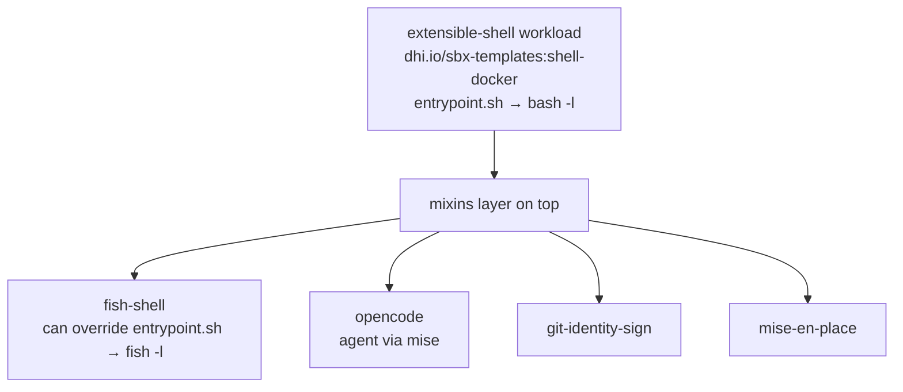

# extensible-shell

The repo's baseline **workload**: a bare, generic shell sandbox that carries a small set of base
tools and whose entrypoint is deliberately overridable, so mixins decide what the sandbox actually
boots into.

- Source: `extensible-shell/extensible-shell.yaml` + `extensible-shell/extensible-shell.dockerfile`
- Kind: `workload` (the repo's only one) · DisplayName: `Extensible shell` · version 1.0.0
- Capabilities: none — everything it does happens at image build time

## Role in the architecture

sbx-kits follows a **compose-don't-specialize** model: one generic workload is the base of every
sandbox, and small focused mixins layer capabilities on top. Agents are *not* workloads — the `pi`
workload worked that way and was removed — they are mixins that install the agent binary,
preferably via [mise-en-place](mise-en-place.md).

## The entrypoint contract

- The Dockerfile writes `/home/agent/entrypoint.sh` (`bash -l`, mode 0700) and sets it as
  `ENTRYPOINT` — the sandbox's login surface.
- The file lives under `/home/agent` so mixins can replace it: the one way to take the seam is an
  install hook running as `user: "1000"` that rewrites the file (truncation keeps it agent-owned;
  `chmod 0700` restores the mode) — hooks run in dependency order, so requirers write after
  providers and win, and lifecycle `files` must not touch the path (duplicate `files` paths are a
  composition error). [fish-shell](fish-shell.md) (`fish -l`) and [opencode](opencode.md)
  (`exec opencode`) take the seam this way, each gated opt-in on its `auto_start` arg
  (default `false`): a composition sets it `true` on exactly the one kit that should boot.
- Base image `dhi.io/sbx-templates:shell-docker` carries the platform floor (`USER agent`,
  `WORKDIR /home/agent/workspace`).

## Base tools

The workload Dockerfile installs the generic tools every sandbox should have, via `apt-get` at
build time (root; build-time egress is unrestricted — the same pattern as the fish-shell build
stage):

- **vim** — installed with `--no-install-recommends`, apt lists removed in the same layer.
- **jq — not installed here.** The platform floor already ships jq 1.8.2 (current latest); an apt
  install would risk shadowing it with trixie's older 1.7.x.
- **yq — deliberately absent.** Debian trixie's `yq` package is the kislyuk Python implementation
  (3.4.3), not the Go mikefarah/yq v4 the name usually means — dropped rather than ship the wrong
  tool.

Tool policy: base tools wanted in *every* sandbox live here; optional and specialized tools are
mixins installed via [mise](mise-en-place.md).

## Invariants

- The workload stays capability-free; capabilities always come from mixins. Its Dockerfile adds
  only base tools — generic tools every sandbox needs — on top of the platform floor; optional or
  specialized tools never land here.
- The entrypoint must remain a plain script under `/home/agent` — that path choice is what makes
  mixin overrides possible.
- Default `bash -l` keeps the sandbox usable with zero mixins.

Related: [summary.md](summary.md) · [fish-shell.md](fish-shell.md) · [opencode.md](opencode.md) · [../practices.md](../practices.md)
