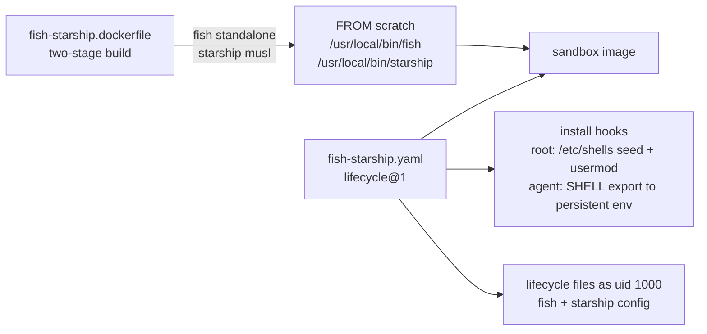

# fish-starship kit

Installs fish and the starship prompt as standalone static binaries, writes their user config at sandbox
creation, and makes fish the login shell of the `agent` user.

## Files

- [fish-starship.yaml](../../fish-starship/fish-starship.yaml) — manifest: one `lifecycle@1` capability with
  two `install` hooks (root: shell registration; agent: `SHELL` export) and five lifecycle `files` entries:
  `config.fish`, `starship.toml`, and three `conf.d` drop-ins (`colors`, `fish_frozen_theme`,
  `fish_frozen_key_bindings`).
- [fish-starship.dockerfile](../../fish-starship/fish-starship.dockerfile) — two-stage build shipping both
  binaries; same pattern as [mise-en-place](mise-en-place.md).

## How it works

## Upstream artifacts

| Tool | Version pin | Asset | Notes |
|---|---|---|---|
| fish | `FISH_VERSION=4.9.3` | `fish-<v>-linux-<arch>.tar.xz` | Release tag has **no** `v` prefix. Tarball is a single self-contained binary: fish 4 embeds its `share/fish` function/completion data (`functions fish_prompt` reports `embedded:functions/…`). |
| starship | `STARSHIP_VERSION=1.27.0` | `starship-<arch>-unknown-linux-musl.tar.gz` | Release tag **has** the `v` prefix. Static musl binary, no runtime deps. |

The dockerfile maps Docker's `TARGETARCH` (`amd64`/`arm64`) to upstream arch names (`x86_64`/`aarch64`) and
fails loudly on anything else. Apple Silicon hosts build `arm64`.

## Design decisions

- **No `network-policy` capability.** Both binaries download during the Dockerfile's image build. Install
  hooks and runtime make no network calls (unlike mise, which fetches tool versions at runtime — see
  [mise-en-place](mise-en-place.md)).
- **Default shell only — no shell handoff.** The kit sets the default shell in `/etc/passwd` and stops
  there; it deliberately does not touch `~/.bash_profile`. Known consequence: the built-in `shell` agent
  hardcodes `bash -l` as its launch command and mixins cannot change a workload's launch command, so
  `sbx run shell` sessions start in bash (the image's `~/.bashrc` prompt with the ✓ glyph). Fish runs where
  the shell is looked up in `/etc/passwd` (SSH, `su`) or by typing `fish`; a guarded `exec fish` in
  `~/.bash_profile` is the mixin-side lever if interactive handoff is ever wanted again.
- **User config ships as lifecycle `files`, not install-hook heredocs.** `files` are written as UID 1000 at
  sandbox creation, parents included, and `overwrite: false` leaves agent edits alone. Heredoc hooks in the
  `agent` user's name also work, but `files` is the documented mechanism for per-user config; a mixin's own
  image layer must never own files under `/home/agent` — a shipped directory replaces the workload's
  directory at that path, owner included.
- **Default shell via `usermod -s` in a root `install` hook — never `sudo`, never `chsh`.** Install hooks run
  as root by default (the `user` field demotes them, e.g. `user: "1000"` for agent-user hooks). `sudo` inside
  hooks fails: hooks run under a filtered `env -i` environment with no TTY, so PAM authentication cannot
  succeed. `chsh` fails even as root: `/etc/pam.d/chsh` makes `pam_shells` a *required* check of the user's
  current shell against `/etc/shells` (absent in this image), and a failed `required` module defeats
  `pam_rootok`'s *sufficient* root bypass, so PAM falls through to a password prompt. `usermod` edits
  `/etc/passwd` directly with no PAM. The hook also seeds `/etc/shells` (`/bin/sh`, `/bin/bash`, fish;
  grep-guarded and idempotent) so the agent's future interactive `chsh` works. The opencode harness is
  unaffected — it invokes bash explicitly.
- **opencode's shell comes from the `SHELL` export in the persistent env.** An agent-user hook exports
  `SHELL=/usr/local/bin/fish` in `/etc/sandbox-persistent.sh`; with that alone, opencode starts fish for its
  terminal and shell tools — the sandbox's agent launch path picks the persistent env up. The documented
  alternative, the `shell` field in opencode's machine-wide `/etc/opencode/opencode.json` ("the shell used by
  the terminal and shell tools", highest config precedence), is available but deliberately unused. fish 4.9.3
  runs `export` and `&&`, so agent-written commands work.
- **`files` paths are absolute.** The runtime does not expand `$HOME` in them.

## Invariants

- Both tools must ship as single self-contained binaries. If a future fish release stops embedding
  `share/fish`, the dockerfile must additionally ship that directory.
- Kit stays self-contained: one manifest plus one dockerfile, nothing else.
- Config bodies live inline in the manifest; bump pinned versions in the dockerfile `ARG`s when upgrading.
- `lifecycle files` content templates `${{ kit.env.* }}`/`${{ kit.args.* }}` but writes plain `$VAR`
  unchanged — config bodies are safe unless they contain `${{`.

Related: [summary.md](summary.md) · [mise-en-place.md](mise-en-place.md) · [../practices.md](../practices.md)
