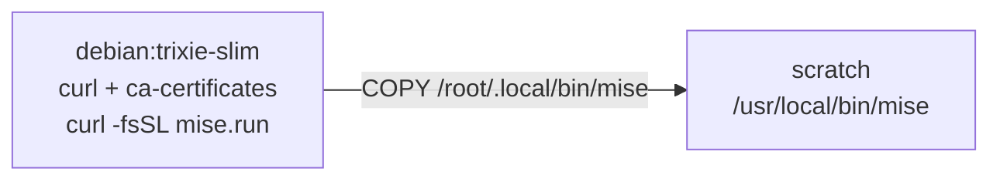

# mise-en-place

Installs the [`mise`](https://mise.jdx.dev) tool version manager, activates it in every shell, and trusts
the workspace's mise config at boot.

- Source: `mise-en-place/mise-en-place.yaml` + `mise-en-place/mise-en-place.dockerfile`
- DisplayName: `Mise en place mixin`
- Capabilities: `com.docker.sandbox/network-policy@2`, `com.docker.sandbox/lifecycle@1`
- Args: none

## Image (dockerfile)

Two-stage build: the final kit image is `FROM scratch` and contains only the `mise` binary at
`/usr/local/bin/mise` — no shell, no package manager.

## Lifecycle

- **install** (image build, user `1000`): `mise activate >> /etc/sandbox-persistent.sh` — activation is
  appended to the sandbox's persistent environment file so every later shell has mise on PATH.
- **startup** (every boot): `mise trust "${WORKSPACE_DIR:?WORKSPACE_DIR is not set}"` with
  `env: [WORKSPACE_DIR]` — trusts the workspace's mise config so its tool versions are honored, and fails
  loudly if the variable is unset.

## Network

- `network-policy@2` runtime allow: `mise.jdx.dev`. Sandbox egress is default-deny; the allow exists so
  mise can download tool versions when installing tools declared by the workspace during the session.

## Invariants

- Binary path is `/usr/local/bin/mise`; activation appends to `/etc/sandbox-persistent.sh`, which must
  never contain shell completion scripts (see that file's rules).
- Activation runs as user `1000`, not root.
