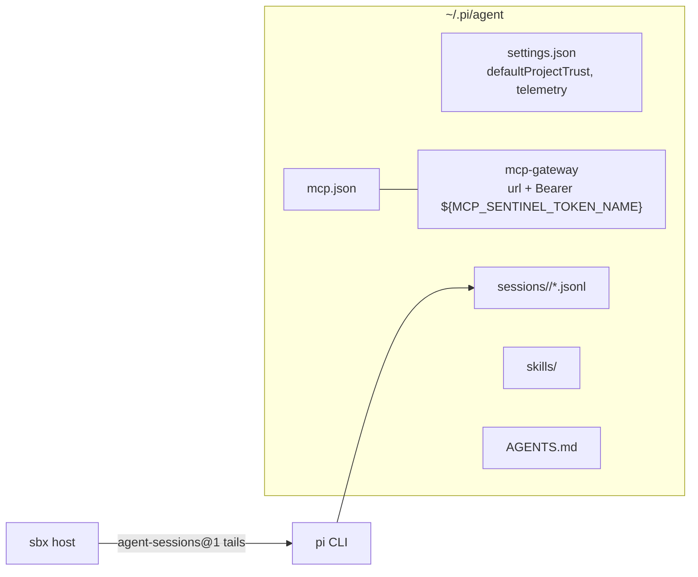

# Pi — agent workload

The repo's first `kind: workload` kit: makes [Pi](https://pi.dev/) (pi.dev, npm
`@earendil-works/pi-coding-agent`, Node ≥ 22.19) the agent the sandbox host launches, modeled on the
spec repo's `examples/opencode` workload. Related: [summary.md](summary.md), [../terminology.md](../terminology.md).

## Layout

- `pi/pi.yaml` — descriptor (`# syntax=docker/sandbox-kit:3`, schemaVersion "3", `kind: workload`)
- `pi/pi.dockerfile` — image content; no other files (the tmux wrapper is a heredoc `COPY`, the session `list` command is inline `sh`)

## Image

`dhi.io/sbx-templates:shell-docker` (Debian 13) already ships Node 24 and an agent-owned npm-global
prefix (`NPM_CONFIG_PREFIX=/usr/local/share/npm-global`), so the Dockerfile installs tmux + fd-find,
pins Pi, seeds the tmux config, and installs the `pi-launch` entrypoint wrapper:

```dockerfile
FROM dhi.io/sbx-templates:shell-docker
ARG PI_VERSION
USER root
RUN sed -i 's|^URIs: http://deb.debian.org|URIs: https://deb.debian.org|' \
      /etc/apt/sources.list.d/debian.sources \
 && apt-get update && apt-get install -y --no-install-recommends tmux fd-find \
 && rm -rf /var/lib/apt/lists/*
# npm install of pi (unchanged) ...
 && ln -s /usr/bin/fdfind /usr/local/share/npm-global/bin/fd \
 && printf 'set -g extended-keys on\nset -g extended-keys-format csi-u\nset -g set-clipboard on\n' \
      > /home/agent/.tmux.conf \
 && chown agent:agent /home/agent/.tmux.conf
COPY <<'EOF' /usr/local/bin/pi-launch
#!/bin/sh
[ -t 0 ] && command -v tmux >/dev/null 2>&1 \
  && exec tmux new-session -A -s pi pi "$@"
exec pi "$@"
EOF
USER agent
WORKDIR /home/agent/workspace
ENTRYPOINT ["/usr/local/bin/pi-launch"]
```

Invariants:

- `ENTRYPOINT ["/usr/local/bin/pi-launch"]` is the launch command. The wrapper gates on `[ -t 0 ]`:
  interactive launches run `tmux new-session -A -s pi pi …` (persistent, detachable); headless
  `agent-sessions@1` runs (no tty) exec `pi` directly so stdout is captured. `tmux new -A` reattach
  ignores the argv tail by design — attaching to the live agent *is* the point; `resume`/`continue`
  tails only matter when no `pi` session exists yet (accepted trade-off, option a).
- `--cache /tmp/npm-cache` is mandatory: the template ships a `/root/.npm` the agent user owns, and
  npm's default cache fails with EACCES under root.
- Pi's own runtime fetches are pre-baked: Pi downloads `fd` on first use (`~/.pi/agent/bin/fd`) and
  warns about tmux's `extended-keys`; the image instead apt-installs `fd-find` (Debian's binary is
  `fdfind`, so a symlink in the agent-owned npm-global bin makes it findable as `fd`) and seeds
  `~/.tmux.conf` with `set -g extended-keys on` + `set -g extended-keys-format csi-u`.
- The template's Debian apt mirrors are plain `http://deb.debian.org` — unreachable where port 80
  egress is blocked (both this sandbox's docker containers and some hosts). The build switches the
  sources to https before `apt-get update`; the runtime allowlist carries both `:80` and `:443` for
  the domain.
- Testing trap that bit twice in the OSC 52 investigation: `sh` in these images is dash, which does
  not support `$'...'` ANSI-C quoting — a `grep $'\x1b]52'` there silently never matches (the
  `|| echo 0` fallback masks it). Analyze byte captures in Python, not shell greps.
- The image sets `LANG=C.UTF-8` + `LC_ALL=C.UTF-8` (`ENV`, built into glibc): the base defaults to
  POSIX, under which tmux draws the TUI's half-block logo glyphs (`▀`/`█`) as underscores — the
  "broken Pi logo" symptom. tmux reads the locale and enables UTF-8 handling itself; no tmux flag
  needed.
- Clipboard writes go through OSC 52: the image sets `PI_CLIPBOARD_OSC52=1`. In the container there
  is no display, but the attach env carries `WAYLAND_DISPLAY`, so Pi otherwise tries `wl-copy`
  (absent) and throws "install `wl-clipboard`… check Wayland access" *before* its OSC 52 fallback —
  the flag short-circuits that dead end. Chain: pi emits OSC 52 → tmux must be told to forward it →
  the client terminal applies it (Ghostty's `clipboard-write` defaults to `allow`).
  **tmux does NOT forward by default**: with `set-clipboard external` (tmux's default) the pane
  sequence is dropped at the door (`if (state != 2) return` in tmux's `input_osc_52`); only
  `set-clipboard on` both stores it and forwards it to the outer terminal. The seeded
  `~/.tmux.conf` therefore carries `set -g set-clipboard on`. Verified end-to-end in the image: a
  pane emitting `OSC 52;c;<b64>` reaches the outer terminal when the server starts from the seeded
  config. Clipboard *reads* from the host clipboard are not fixable in the container — no
  `wl-paste`/`xclip`, and terminals do not answer OSC 52 reads by default; pasting happens via the
  terminal's own paste. Host-confirmed: writes land on the macOS clipboard through this chain
  (Ghostty/tmux/pi, Nov 2026).
- Docker-run quirk worth remembering when testing: `docker run  sh -c '...'` appends to the
  entrypoint, so shell probes need `--entrypoint sh`; `docker run -t` is the easy way to exercise
  the interactive (tmux) branch of the wrapper.

## Capabilities

| Capability | Role |
|---|---|
| `sbx@1` | agent-sandbox declaration (workload-only, no config) |
| `network-policy@1` | runtime egress: pi.dev, npm registry, GitHub zones, provider API domains, `deb.debian.org:80`+`:443` + `dhi.io:80` (the workload owns its base's apt mirrors) |
| `credential@1` ×1 | optional proxy-managed env sentinel: `GITHUB_TOKEN` (api/raw/github.com inject). The provider API domains stay in the allowlist without credentials, so adding a provider is one `credential@1` capability, no allowlist edit |
| `lifecycle@1` | root install hook re-owns `/home/agent/.pi` + `/home/agent/.pi/agent`; agent install hooks seed `settings.json` and register the MCP gateway; startup hook re-registers as fallback |
| `agent-sessions@1` | headless surface |
| `agent-interactive-sessions@1` | TUI surface (optional) |
| `agent-skills@1` | `/home/agent/.pi/agent/skills` (optional) |
| `agent-context@1` + `@2` | sandbox-context `AGENTS.md` into `/home/agent/.pi/agent` (optional, same config anchored) |

Deliberately out of scope: `acp@1` (Pi speaks RPC/JSON, not ACP) and subscription OAuth
(`/login` needs a browser; no documented `auth.json` structure to render into).

## Pi specifics the kit depends on



- Sessions: `~/.pi/agent/sessions/<--encoded-path-->/<timestamp>_<uuid>.jsonl`; first line is the
  header `{"type":"session",...,"id":"..."}`. `--session` accepts a path or full/partial ID.
- `list` prints header `.id` per file, newest mtime first, via
  `find -printf '%T@\t%p\n' | sort -rg | cut -f2-` + `jq -r 'select(.type=="session") | .id // empty'`
  (the `select` keeps a malformed first line from emitting a bogus id).
- Tails (all verified real flags): headless `prompt: ["-p","--","{{.Prompt}}"]`,
  `continue: ["--continue"]`, `resume: ["--session","{{.SessionID}}"]`; interactive
  `prompt: ["--","{{.Prompt}}"]`, `sessionPicker: ["--resume"]`. Interactive tails land on the
  `pi` argv inside the tmux wrapper, so they are swallowed when reattaching to a live session.
- Project trust: print/JSON/RPC modes never prompt; `defaultProjectTrust: "ask"` (Pi's default)
  would silently ignore project `.pi/` resources. The seed sets `"always"` — the sandbox trust model,
  same spirit as the Claude workload's bypassPermissions.
- `pi mcp add <name> --url <url> --bearer-token-env-var <NAME>` writes the user-level `mcp.json`
  and **replaces** on re-add, so re-create is idempotent and the startup fallback cannot delete an
  entry out from under a live session.
- Settings seed merges (`{...cur, ...seed}`) instead of rewriting: install hooks run on every
  (re)create and the file is the agent's main config.

## Verification performed

Build through the frontend (`docker buildx build -f pi/pi.yaml pi/`), then in the composed image:
`pi --version` matches the pin; no root-owned files under `/home/agent`; settings seed idempotent
with user keys retained; MCP hook writes `Bearer ${MCP_SENTINEL_TOKEN_NAME}`, replaces idempotently,
no-ops without `MCP_GATEWAY_URL`; session `list` orders newest-first and skips header-less files;
`pi -p -- "…"` reaches the agent loop (fails on the unbound provider key as expected); with
`docker run -t`, the wrapper routes through `tmux new-session -A -s pi` (verified via a stub `pi`
logging its ancestor chain) and the session dies cleanly when pi exits; without a tty the wrapper
execs `pi` directly. socat's `EXEC:,pty` did not put a tty on the child's fd 0 in this container —
use `docker run -t` for the interactive branch, not socat. First real `sbx run` on the host surfaced
Pi's runtime fetches, now pre-baked: `fd --version` (fdfind 10.2.0 via the `fd` symlink), tmux 3.5a,
`~/.tmux.conf` seeded agent-owned with `extended-keys on` + `extended-keys-format csi-u` — and the https mirror switch made
`apt-get update` work where plain-http egress was blocked.

Validation gap learned: a plain `docker buildx build -f kit.yaml` composes layers and parses the
descriptor but does not run the host's cross-capability checks (e.g. credential inject domains
must sit inside the network policy's allow list — inject-within-allow). Only `sbx` resolution
catches those; expect the first `sbx run` to surface them.

Host prerequisite: `dhi.io` (Docker Hardened Images) requires authentication — `docker login dhi.io`
with a Docker ID or PAT. Anonymous pulls 401 at the token endpoint, which surfaces as a kit-build
failure; a Docker-managed sandbox environment may pull anonymously, a personal host does not.
