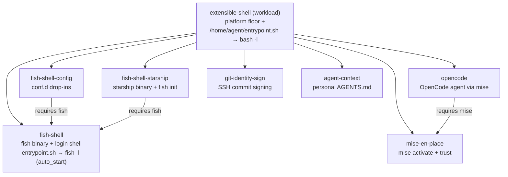

# Kits — catalog

sbx-kits follows a **compose-don't-specialize** model: one generic **workload** is the base of every
sandbox and small focused **mixins** layer capabilities on top. Agents are mixins too — they install
their binary, preferably via mise — not dedicated workloads (the `pi` workload worked that way and
was removed when this model landed).

| Kit | Kind | DisplayName | Args | Provides / Requires | Capabilities | Files |
|---|---|---|---|---|---|---|
| [extensible-shell](extensible-shell.md) | **workload** | Extensible shell | — | — | — | `extensible-shell.yaml`, `extensible-shell.dockerfile` |
| [agent-context](agent-context.md) | mixin | Personal AGENTS.md | — | — | `agent-context@1` | `agent-context.yaml` |
| [git-identity-sign](git-identity-sign.md) | mixin | Git identity + signing | `git_user_name`, `git_user_email`, `git_user_signingKey` (required) | — | `ssh-agent@1`, `lifecycle@1` | `git-identity-sign.yaml` |
| [mise-en-place](mise-en-place.md) | mixin | Mise tool manager | — | provides `mise` | `network-policy@2`, `lifecycle@1` | `mise-en-place.yaml`, `mise-en-place.dockerfile` |
| [fish-shell](fish-shell.md) | mixin | Fish shell | `auto_start` (default `false`) | provides `fish` | `lifecycle@1` | `fish-shell.yaml`, `fish-shell.dockerfile` |
| [fish-shell-config](fish-shell-config.md) | mixin | Fish configuration | — | requires `fish` | `lifecycle@1` | `fish-shell-config.yaml` |
| [fish-shell-starship](fish-shell-starship.md) | mixin | Starship prompt | — | requires `fish` | `lifecycle@1` | `fish-shell-starship.yaml`, `fish-shell-starship.dockerfile` |
| [opencode](opencode.md) | mixin | OpenCode agent | `auto_start` (default `false`), `opencode_version` (default `2.3.2`) | requires `mise` | `network-policy@2`, `lifecycle@1` | `opencode.yaml` |

## How a sandbox composes

The workload's entrypoint is the composition seam: it ships `bash -l`, and mixins rewrite
`/home/agent/entrypoint.sh` from an install hook (agent user) to choose the boot shell —
[fish-shell](fish-shell.md) (`fish -l`) and [opencode](opencode.md) (`exec opencode`) do exactly
that. Overrides are **opt-in by convention**: each kit gates its write behind an
`auto_start` arg defaulting `false`, so a composition turns it on for exactly the one kit
that should boot. Hooks run in dependency order, so a requirer composed after the boot kit (a tmux
mixin, say) writes last and wins.

## Invariants

- `schemaVersion` and the `# syntax=` header move together; bump both when upgrading the kit schema.
- Capabilities are versioned independently (`network-policy@2` vs the others at `@1`).
- Kits stay self-contained: one directory per kit, at most one YAML manifest plus an optional
  Dockerfile. Workloads may additionally ship script files beside the manifest (the spec's own
  agent examples do); mixins should not.
- Mixins overlay; workloads are the base. `sbx@1` is workload-only (the schema refuses it in a
  mixin's capabilities). extensible-shell declares no capabilities at all.
- One generic workload per sandbox; never create a new workload for a tool or agent — write a mixin.
- Every manifest carries a semver `version` field — assigned by the release workflow (planned), never bumped by hand in a kit change.

Related: [../summary.md](../summary.md) · [../terminology.md](../terminology.md) · [../practices.md](../practices.md)
