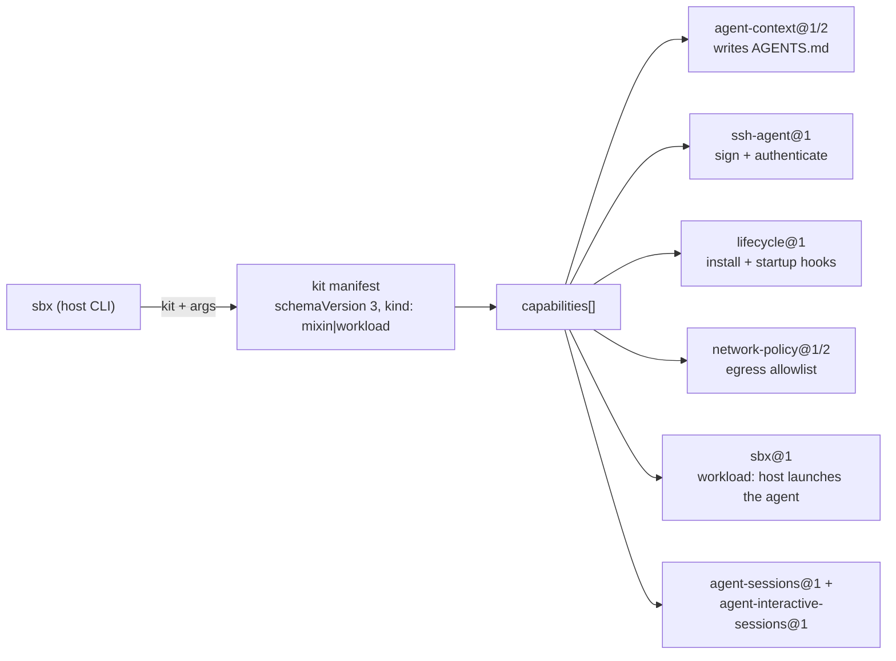

# Kits — catalog

Kits come in two kinds. All existing kits were `kind: mixin` (overlay layers); `pi` is the first
`kind: workload` (root filesystem + the agent the host launches, declared with `com.docker.sandbox/sbx@1`).
A sandbox is assembled from one or more kits; the `sbx` runtime applies each capability, substituting kit args into capability config.

| Kit | Kind | DisplayName | Args (required) | Capabilities | Files |
|---|---|---|---|---|---|
| [agent-context](agent-context.md) | mixin | My personal AGENTS.md | — | `agent-context@1` | `agent-context.yaml` |
| [git-identity-sign](git-identity-sign.md) | mixin | Git identity and commit signing | `git_user_name`, `git_user_email`, `git_user_signingKey` | `ssh-agent@1`, `lifecycle@1` | `git-identity-sign.yaml` |
| [mise-en-place](mise-en-place.md) | mixin | Mise en place mixin | — | `network-policy@2`, `lifecycle@1` | `mise-en-place.yaml`, `mise-en-place.dockerfile` |
| [fish-starship](fish-starship.md) | mixin | Fish shell and Starship prompt | — | `lifecycle@1` | `fish-starship.yaml`, `fish-starship.dockerfile` |
| [pi](pi.md) | workload | Pi | — (`version` has a default) | `sbx@1`, `network-policy@1`, `credential@1` ×1 (github), `lifecycle@1`, `agent-sessions@1`, `agent-interactive-sessions@1`, `agent-skills@1`, `agent-context@1`+`@2` | `pi.yaml`, `pi.dockerfile` |

## How a kit becomes sandbox behavior

## Invariants

- `schemaVersion` and the `# syntax=` header move together; bump both when upgrading the kit schema.
- Capabilities are versioned independently (`network-policy@2` vs the others at `@1`).
- Kits stay self-contained: one directory per kit, at most one YAML manifest plus an optional
  Dockerfile. Workloads may additionally ship script files beside the manifest (the spec's own
  agent examples do); mixins should not.
- Mixins overlay; workloads are the base. `sbx@1` is workload-only (the schema refuses it in a
  mixin's capabilities).
