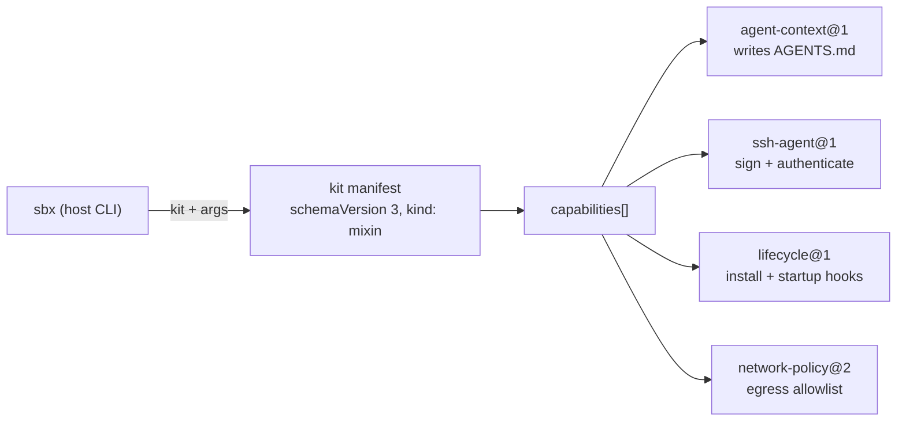

# Kits — catalog

All kits are `kind: mixin` manifests at `schemaVersion: 3`. A sandbox is assembled from one or more
kits; the `sbx` runtime applies each capability, substituting kit args into capability config.

| Kit | DisplayName | Args (required) | Capabilities | Files |
|---|---|---|---|---|
| [agent-context](agent-context.md) | My personal AGENTS.md | — | `agent-context@1` | `agent-context.yaml` |
| [git-identity-sign](git-identity-sign.md) | Git identity and commit signing | `git_user_name`, `git_user_email`, `git_user_signingKey` | `ssh-agent@1`, `lifecycle@1` | `git-identity-sign.yaml` |
| [mise-en-place](mise-en-place.md) | Mise en place mixin | — | `network-policy@2`, `lifecycle@1` | `mise-en-place.yaml`, `mise-en-place.dockerfile` |
| [fish-starship](fish-starship.md) | Fish shell and Starship prompt | — | `lifecycle@1` | `fish-starship.yaml`, `fish-starship.dockerfile` |

## How a kit becomes sandbox behavior

## Invariants

- `schemaVersion` and the `# syntax=` header move together; bump both when upgrading the kit schema.
- Capabilities are versioned independently (`network-policy@2` vs the others at `@1`).
- Kits stay self-contained: at most one YAML manifest plus an optional Dockerfile; no shared files across kit directories.
