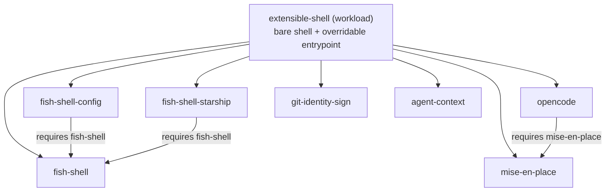

# Docker Sandbox Kits

A personal collection of [Docker Sandbox](https://docs.docker.com/) kits: one extensible base workload and reusable mixins that customize
sandboxes built with the `sbx` CLI.

## Design

These kits are **ingredients for building your own sandbox**, not finished recipes: a minimal extensible base, a set of
small, highly reusable parts, and the freedom to compose — or fork and remix — the environment you want. Four choices
give the collection its shape.

### One workload, many mixins

A sandbox boots from exactly one **workload**: the base image the host starts. This repo has exactly one,
[`extensible-shell/`](extensible-shell/) — a bare shell sandbox on `dhi.io/sbx-templates:shell-docker` whose only
opinion is an overridable `/home/agent/entrypoint.sh`. Everything else is a **mixin**: a small, focused layer that
customizes the sandbox without owning it. Tools and agents are mixins too — [`opencode/`](opencode/) installs its
agent through [`mise`](https://mise.jdx.dev/) rather than defining a second workload. Missing a tool? Write a mixin;
never fork the workload.



### The entrypoint is the seam

`extensible-shell` boots `bash -l` from `/home/agent/entrypoint.sh`; a mixin can rewrite that file from an install
hook to choose what boots instead — [`fish-shell/`](fish-shell/) writes `fish -l`, [`opencode/`](opencode/) writes
`exec opencode`. Overrides are opt-in by convention: the rewrite is gated behind an `auto_start` arg (default
`false`), and a composition turns it on for exactly the one kit that should take over the boot shell. Install hooks
run in dependency order, so a mixin composed after the boot kit can wrap the entrypoint again — the last writer wins.

### Declared dependencies, versioned capabilities

Kits compose without reaching into each other. Dependencies are explicit in both directions: a mixin declares
**requires** ([`fish-shell-config/`](fish-shell-config/) requires `fish-shell`, [`opencode/`](opencode/) requires
`mise-en-place`),
providers declare **provides**, and a composition fails closed when nothing in the set satisfies a requirement —
requirements never pull kits in behind your back. Customization of the sandbox itself is requested through
**capabilities**, versioned units such as `lifecycle@1` (install/startup hooks, config files), `network-policy@2`
(egress allowlist), `ssh-agent@1`, and `agent-context@1`.

### Secure by default

- Network egress is **default-deny at runtime** (install-phase egress is open while install hooks run); a kit that
  downloads anything during a session declares an explicit allow (`mise-en-place` allows `mise*.jdx.dev`, `opencode`
  allows `opencode.ai`).
- [`git-identity-sign/`](git-identity-sign/) scopes the ssh-agent to signing only (`sign: [git]`): commits are signed
  with your key, but remote authentication is not the agent's to perform — it comes from Docker Sandbox secret
  injection at runtime.

## Kits

Each kit is a self-contained directory with a YAML manifest declaring capabilities and the args they consume. Some kits
also ship a Dockerfile for staged installation.

| Kit                                        | Purpose                                                                       | Capabilities                      |
|--------------------------------------------|-------------------------------------------------------------------------------|-----------------------------------|
| [`extensible-shell/`](extensible-shell/)   | **Workload:** bare shell sandbox with an overridable entrypoint               | —                                 |
| [`agent-context/`](agent-context/)         | Injects a personal `AGENTS.md` into the agent config directory                | `agent-context@1`                 |
| [`git-identity-sign/`](git-identity-sign/) | Configures Git identity with SSH commit signing                               | `ssh-agent@1`, `lifecycle@1`      |
| [`mise-en-place/`](mise-en-place/)         | Installs and activates the `mise` tool manager                                | `network-policy@2`, `lifecycle@1` |
| [`fish-shell/`](fish-shell/)               | Installs fish, makes it the `agent` user's login shell                        | `lifecycle@1`                     |
| [`fish-shell-config/`](fish-shell-config/) | Fish configuration drop-ins: colors, theme, key bindings, abbreviations       | `lifecycle@1`                     |
| [`fish-shell-starship/`](fish-shell-starship/) | Installs the starship prompt and wires it into fish                       | `lifecycle@1`                     |
| [`opencode/`](opencode/)                   | Installs the [OpenCode](https://opencode.ai/) coding agent via `mise`         | `network-policy@2`, `lifecycle@1` |

## Kit anatomy

```
<kit>/
    <kit>.yaml            # manifest: displayName, args, capabilities[]
    <kit>.dockerfile      # optional, for two-stage installs
```

- **Capabilities** are versioned units of customization: `agent-context@1`, `ssh-agent@1`, `lifecycle@1`,
  `network-policy@2`.
- **Args** (e.g. `git_user_name`, `git_user_email`, `git_user_signingKey`) are declared under `args:` and referenced as
  `${{ kit.args.NAME }}`.

## Documentation

- [Author kits](https://docs.docker.com/ai/sandboxes/customize/author/) — descriptor and Dockerfile layout, capabilities, lifecycle hooks
- [Use kits](https://docs.docker.com/ai/sandboxes/customize/use-kits/) — running and combining kits with `sbx run` and `--kit`
- [Build and distribute kits](https://docs.docker.com/ai/sandboxes/customize/author/distribute/) — publishing kit images to a registry
- [docker/sbx-kits-contrib](https://github.com/docker/sbx-kits-contrib) — Docker's community kit sources and kit spec
- Tools shipped by these kits: [mise](https://mise.jdx.dev/), [fish](https://fishshell.com/), [starship](https://starship.rs/), [opencode](https://opencode.ai/)
